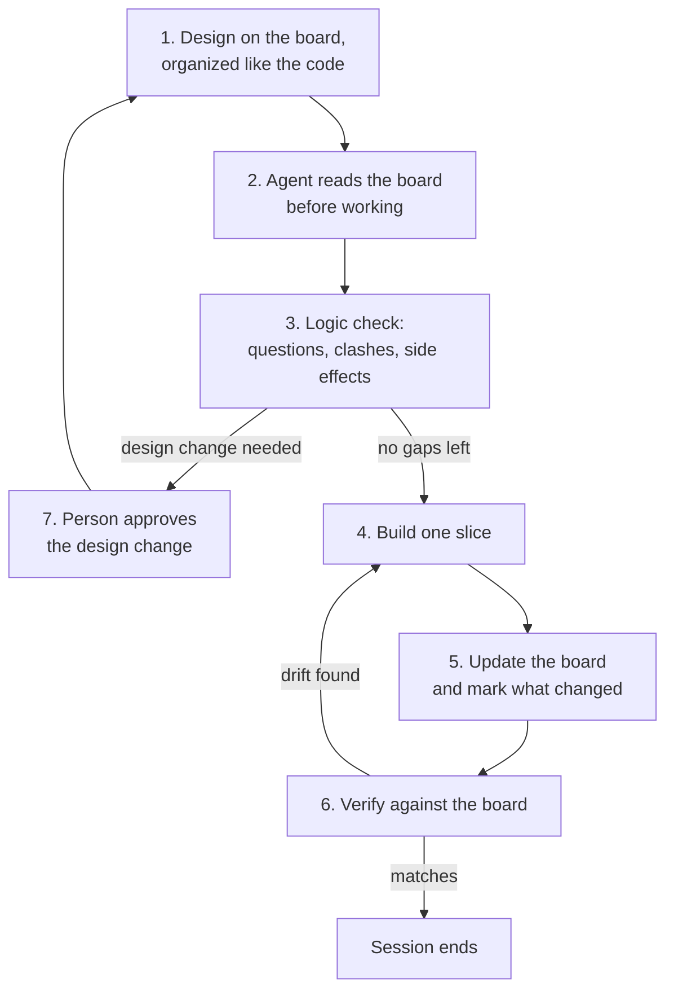

# Facilitator guide

**Module:** Keep AI Coding Agents Consistent with a Source-of-Truth Board
**Audience:** developers starting to build with AI coding agents. Some experience with a coding agent helps. No Flowboard experience needed.
**Length:** 90 minutes, 55 of them hands-on.
**Group size:** works for one person or a room. In a room, learners work alone or in pairs.

## Objectives

By the end, learners can:

1. **Structure** a design board so its sections and shapes mirror the code's systems.
2. **Write** an agent instruction that makes the board's Markdown export the source of truth.
3. **Run** a logic check with an agent before building, and turn its findings into board changes.
4. **Detect** drift by comparing an agent's build with the board: changed numbers, dropped rules, contradicted decisions and skipped tasks.
5. **Decide** which changes an agent may make on its own and which need a person's approval.

## Core ideas

**The problem.** An agent forgets between sessions, and sometimes within a long one. Common symptoms:

- New work quietly breaks or removes a feature that already worked.
- In a long session, the agent stops following details it followed earlier.
- The agent writes a task list and finishes only part of it, then reports it as done.
- A change to one system has side effects in others that nobody thought through.

Tests don't catch all of this. An agent writes tests for the code it wrote, so its tests can agree with its own mistakes.

**The fix.** Keep the design outside the conversation, in one place both you and the agent read: a board whose Markdown export lives in the repo. The board mirrors the code. Each section is one system or file. Each shape uses one fixed format:

| Line | What goes there |
|---|---|
| State | What this thing remembers |
| Each tick | What it does every update (or every request, frame or job) |
| Rules | What must always be true |
| Events | What it reports or triggers |
| Numbers | Every number it uses |

The format makes gaps obvious. An empty Numbers line, or a rule with no shape, is a question to answer before building.

**Why Flowboard in the lab.** Flowboard boards save as plain Markdown ([format guide](https://github.com/kashihashi95/flowboard/blob/main/FLOWBOARD-MARKDOWN.md)). An agent can read and edit them, and they go in the repo next to the code. Learners can open a `.md` file with **Open file** or by dragging it onto the board, and save with **Export → Markdown**. Sections are `## Section: Name` headings, and `## Connections` lists the arrows. Any board tool with a text export works for the practice. Flowboard is just the one used here.

## The loop

1. **Design on the board first.** Decisions, rules and numbers live on the board, in sections that match the code.
2. **The agent reads the board before working.** An instruction file (`AGENTS.md`, `CLAUDE.md` or your agent's equivalent) says so, every session.
3. **Logic check.** Before building, the agent asks questions until nothing is unclear, looks for rules that clash, and follows the change into every system it touches.
4. **Build one slice.**
5. **Update the board before the session ends, and mark what changed.** In Flowboard, **Start track** before the session, then use **Diff → Highlight changes on the board** (Shift+D) or the **Timeline** to see what's new or edited. A fixed outline color on changed shapes (for example `outline=orange`) works as a manual convention too.
6. **Verify against the board.** Compare the code, and the old board version, with the board: dropped numbers, contradicted rules, forgotten decisions, skipped tasks.
7. **A person approves design changes.** The agent proposes. The person decides, and the decision goes in the Change log.

### An example from the author's practice

On a Stone Age village-building game, a planning-stage logic check looked at adding charging boars to the enemy list. It found that a boar would have made grown-ups hide, sent anyone armed to fight it, and called the scout home mid-trip. All three were fixed before any code was written. That is step 3 at work: one design change, followed into villager AI, combat and scouting.

Use it to make the point: the cheapest drift to fix is the drift that never gets built.

## Session plan (90 minutes)

| Time | Min | Activity | Hands-on |
|---|---|---|---|
| 0:00 | 10 | **Open.** Ask: "When has an agent forgotten something you'd already decided?" Collect two or three stories. Name the symptoms from Core ideas. | |
| 0:10 | 15 | **Teach the loop.** Walk through the diagram. Open `lab/starter/board/village-design.md` in Flowboard and show how each section matches a file in `src/`. Read `lab/starter/AGENTS.md` aloud. | |
| 0:25 | 15 | **Lab Part A: map the Granary.** Learners add the Granary to the board, then run a logic check with their agent. | ✔ |
| 0:40 | 15 | **Lab Part B: build one slice.** The agent builds the Granary from the board and updates the board before ending. | ✔ |
| 0:55 | 10 | **Lab Part C: verify.** Learners compare the build with the board, using the job aid. | ✔ |
| 1:05 | 15 | **Lab Part D: drift hunt.** Learners find the three problems in `lab/seeded-drift/` using only the board. Debrief with the answer key. | ✔ |
| 1:20 | 7 | **Knowledge check.** Six scenarios, individually. Go over any question that more than one person missed. | |
| 1:27 | 3 | **Close.** Hand out the job aid. Each learner names one project where they'll set up a board this week. | |

Hands-on total: 55 of 90 minutes.

### Facilitator notes

- **No agent access?** Learners can do Part B by hand, or skip it. Parts A, C and D still work.
- **Part A, what a good logic check raises.** The brief leaves these open on purpose: Does smoked meat spoil? Does raw meat? Where does spoiling go in the tick order: before or after villagers eat? Does the Granary need a worker? What happens to food above its capacity? A learner whose agent didn't raise at least two of these should ask it to check again.
- **Part D.** The seeded build's own tests pass. Make sure learners notice that. It is the point of the exercise.
- **Running long?** Shorten Part B to "agent proposes the board changes only".

## Measurement plan

Measure before and after. Collect a baseline for four to six weeks before the training, then keep collecting the same way. Every target is relative to the team's own baseline. Set the actual numbers with the team after the baseline is in.

| Level | Question | How to measure | Target |
|---|---|---|---|
| 1. Reaction | Did learners find it useful and relevant? | Three-question survey at the end: relevance, confidence to use it, what's unclear. | Most learners rate relevance high. Act on every "unclear" comment. |
| 2. Learning | Can they do it? | Knowledge check score. Number of the three seeded problems found in Part D. | Each learner passes the knowledge check (5 of 6) and finds all three seeded problems. |
| 3. Behavior | Do they use it on real work? | Check projects 30 and 60 days later: is there a board export in the repo, an agent instruction file that points to it, and Change log entries dated after the training? | A rising share of active projects have all three, compared with the baseline. |
| 4. Results | Does it reduce rework? | Count per feature: rework requests, design decisions lost between sessions (a decided rule or number that later had to be restored), and drift caught before merge versus after. | Fewer rework requests and lost decisions per feature than the baseline, and a larger share of drift caught before merge. |

Keep the counting simple. A tag on each issue or review comment ("rework", "lost decision", "drift caught before merge", "drift caught after merge") is enough.

## Keeping it current

Recheck these when the tools change:

- **Flowboard.** After a Flowboard update, confirm that **Open file**, **Export → Markdown**, **Start track**, **Diff** (Shift+D) and **Timeline** still work as described. Reopen `lab/starter/board/village-design.md` and check it loads with no skipped-line warnings. Check that the format guide still says to leave the `<!-- flowboard:history` block as it is.
- **Agents.** When an agent changes how it loads instruction files, recheck that `AGENTS.md` (and `CLAUDE.md`, which points to it) is read at the start of a session.
- **Node.js.** Run `npm test` in `lab/starter` and `lab/seeded-drift` on the current LTS release. Update [TESTED.md](TESTED.md).
- **Seeded drift.** If you change the board or the starter code, recheck the seeded build against the 11 board facts listed in [TESTED.md](TESTED.md), and update the line numbers in [lab/answer-key.md](lab/answer-key.md). The seeded build must still break exactly three of them.
